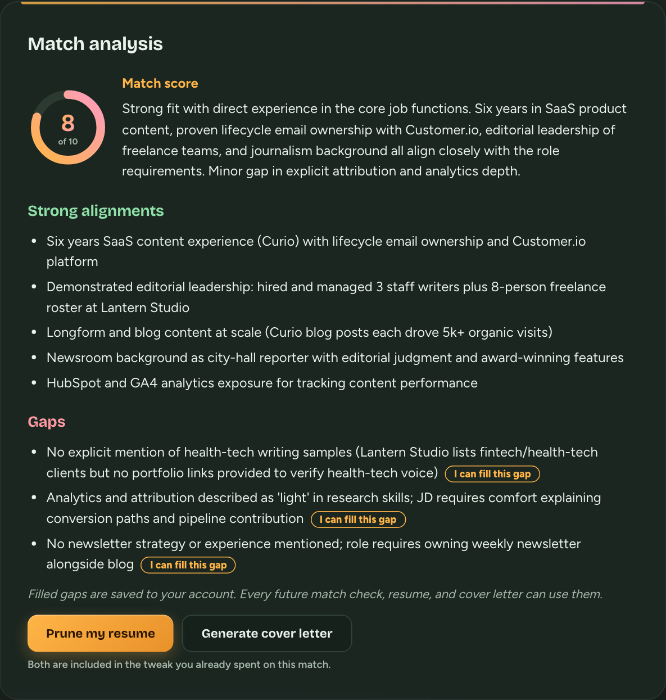
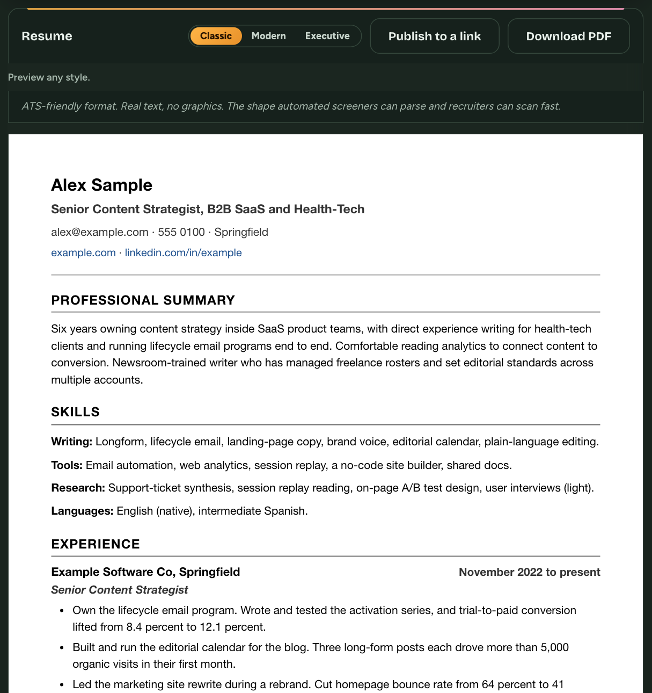
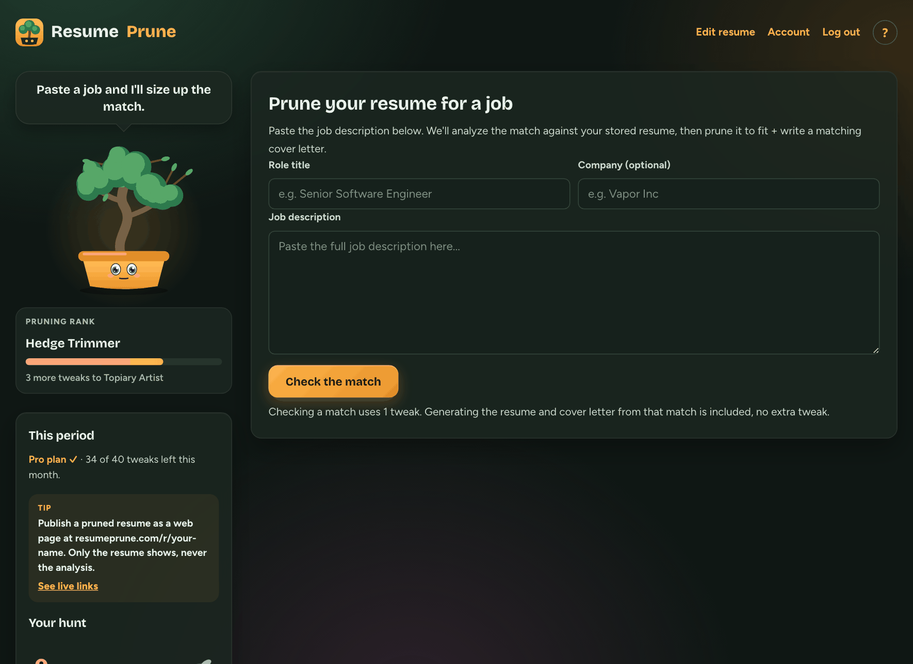

# Resume Prune 🪴

**For anyone applying to jobs.** Paste a job posting and Resume Prune trims the resume you already have to fit it, then writes a matching cover letter. It works only from what's really in your resume, and it shows you every cut and why.

**[Start with a free plan at resumeprune.com](https://resumeprune.com)**. No signup, no card. Or run your own copy with the code in this repo.



---

## What it does

| Feature | What you get |
|---|---|
| **Match check** | A score out of 10 for your resume against the posting, with what lines up and what's missing. |
| **Pruned resume** | A single-column, real-text resume with standard headings. It can rephrase, reorder and cut what you wrote. It's built not to add anything new. |
| **Pruning report** | Every cut, with the reason next to it. |
| **Cover letter** | A short letter written from the same resume and posting. |
| **Fill a gap** | Missing something you really did? Add it once, and later checks and resumes can use it. |
| **Cleanup tips** | Rule-based suggestions, like dated phrases and old roles that could be shorter. No AI call needed. |
| **PDF downloads** | Classic, Modern and Executive styles. |
| **Live resume links** | Publish a resume as a web page at `/r/your-name`. Up to 5 at once. Only the resume shows, never the analysis. |
| **Job tracker** | Tweak history and a status for every job you've applied to. |
| **Twig** | A small bonsai who cheers you on, plus pruning ranks to climb. |

<p>
  
  
</p>

## Two ways to use it

### 1. Use the hosted version

**[resumeprune.com](https://resumeprune.com)** is ready to go, with nothing to set up.

| Plan | Price | Tweaks | Includes |
|---|---|---|---|
| **Free plan** | $0 | 2 a month | Match analysis, resume and cover letter. No signup. |
| **Sprint** | $9 a week | 20 a week | Saved base resume, history, job tracker, saved experience, live resume links, all three PDF styles. |
| **Pro** | $14 a month | 40 a month | Everything in Sprint, on a monthly reset. |

### 2. Run your own copy

You'll need [Node.js](https://nodejs.org) 22.13 or newer, a free [Cloudflare](https://cloudflare.com) account and an [Anthropic API key](https://console.anthropic.com). AI calls are billed to your key.

```bash
git clone https://github.com/jensoltys/resumeprune.git
cd resumeprune
npm ci
cp .dev.vars.example .dev.vars
# In .dev.vars, set JWT_SECRET (openssl rand -hex 32) and ANTHROPIC_API_KEY
npx wrangler d1 migrations apply resume_prune --local
npm run dev
```

Open http://localhost:8787. With no email key set, signup codes print in your terminal, and the signup page tells you to look there.

A few things to know about a fresh copy:

- **No plan needed.** Until you add Stripe, every account can use everything, with no tweak limit and no upgrade prompts. Anyone who can sign up is spending your AI key, so keep a copy like that to people you trust.
- **No AI key yet?** The app still runs. Anything that needs AI answers "AI isn't set up on this copy" until you add `ANTHROPIC_API_KEY`.
- **Logins on localhost.** The login cookie is marked `Secure`. Chrome and Firefox accept it on `http://localhost`. If your browser won't keep you logged in locally, switch to one of those two or test over https.

To put it online:

```bash
npx wrangler d1 create resume_prune
# Paste the database ID into wrangler.toml, and set APP_URL to your address
npx wrangler d1 migrations apply resume_prune --remote
npx wrangler secret put JWT_SECRET
npx wrangler secret put ANTHROPIC_API_KEY
npx wrangler secret put RESEND_API_KEY
npx wrangler secret put TURNSTILE_SECRET_KEY
npm run deploy
```

| Setting | Needed? | What it's for |
|---|---|---|
| `JWT_SECRET` | Required | Signs logins. The app refuses to run sessions if it's under 32 characters. |
| `ANTHROPIC_API_KEY` | Required | The AI calls. |
| `APP_URL` | Required | Your site's address, used in emails and billing links. |
| `RESEND_API_KEY`, `EMAIL_FROM` | Required live | Signup codes and other email. |
| `TURNSTILE_SITE_KEY`, `TURNSTILE_SECRET_KEY` | Required live | The bot check. Without the secret, the no-account tool refuses requests. |
| `GLOBAL_SAMPLE_CAP` | Recommended | Daily ceiling on no-account AI calls, across all visitors. Set to 50 here, and it falls back to 50 if it's blank. |
| `FREE_PARSE_DAILY_CAP` | Optional | Daily ceiling on AI resume reads by accounts with no plan, across all of them. Only matters once paid plans are on. Set to 200 here, and it falls back to 200 if it's blank. |
| `STRIPE_SECRET_KEY`, `STRIPE_WEBHOOK_SECRET`, `STRIPE_PRICE_PRO`, `STRIPE_PRICE_SPRINT` | Optional | Paid plans. Point a Stripe webhook at `/api/stripe/webhook`. Until the secret key and at least one price are set, the pages hide prices and plan buttons. |
| `STRIPE_AUTOMATIC_TAX` | Optional | `"true"` adds Stripe Tax to checkout. It's `"false"` here. Turn on Stripe Tax in your Stripe dashboard first (head office address set, status active), or every checkout fails. Stripe charges a fee for it on each sale. |
| `ALERT_WEBHOOK_URL`, `ALERT_TOKEN` | Optional | A ping when the server hits an error. |
| `SIGNUP_WEBHOOK_URL`, `N8N_SIGNUP_WEBHOOK_SECRET` | Optional | A ping on each signup. |
| `AFFILIATE_API_URL`, `CONVERSION_WEBHOOK_SECRET` | Optional | Sends paid sales to your own affiliate system. |
| `RESUME_COMP_SECRET` | Optional | Turns on two operator-only routes, `POST /api/internal/comp-code` and `POST /api/internal/revoke-access`, which give or take back a plan for an email address with no payment. Callers send the secret in an `X-Internal-Secret` header. Blank means both routes refuse everyone. If you set it, make it long and random (`openssl rand -hex 32`). |
| `TEST_EMAILS`, `TEST_BYPASS_KEY` | Optional | For your own test scripts. A request for an address in `TEST_EMAILS` (comma-separated) that also sends `TEST_BYPASS_KEY` in an `X-RP-Test-Key` header skips the bot check and the no-account limits. Both blank means nobody skips anything. Make the key long and random. |

Plan limits live in `src/lib/usage.js`. The no-account limits live in `checkFreeSampleLimit` in `src/routes/sample-routes.js`.

Not using Stripe? There's nothing to do. With the Stripe settings blank, accounts need no plan and tweaks aren't limited. The plan limits only switch on once `STRIPE_SECRET_KEY` and at least one price are set.

Selling plans and want to give someone one without a payment? Set it yourself. Use `--local` while testing on your machine and `--remote` for your live database:

```bash
npx wrangler d1 execute resume_prune --local --command "UPDATE users SET plan='pro', plan_expires=4102444800 WHERE email='you@example.com'"
npx wrangler d1 execute resume_prune --remote --command "UPDATE users SET plan='pro', plan_expires=4102444800 WHERE email='you@example.com'"
```

## Before you run it publicly

- Replace `YOUR COMPANY NAME`, `YOUR BUSINESS ADDRESS`, `support@example.com` and `privacy@example.com` throughout `public/` and `src/`. That includes the unsubscribe address in `src/email.js`.
- In `public/.well-known/security.txt`, change `security@example.com` and the `Canonical` address to your own.
- Have your own privacy policy, terms and refund policy. The pages in `public/legal/` are a starting point, not legal advice. Fill in `YOUR STATE`, `YOUR COUNTY`, `YOUR ENTITY TYPE`, `YOUR DOMAIN`, `YOUR SPRINT PRICE`, `YOUR PRO PRICE`, `YOUR REFUND POLICY` and `YOUR TESTING PROCESS`, pick your own governing law, and check every claim in the privacy page's security section and the accessibility page against what you really do. People paste whole resumes into this app, so take the privacy page seriously.
- If you charge different prices than Sprint at $9 a week and Pro at $14 a month, change them in all of these spots: `public/index.html` (hero button, plan cards, comparison table, the "Why pay by the week?" card and the FAQ), `public/try.html` (top button and plan cards), `public/guide.html` (plans table and FAQ), `public/account.html` (plan label and upgrade buttons), `public/signup.html` (plan label), `public/claim.html` (`PLAN_LABELS`), `public/legal/terms.html` (section 4) and the free-sample email in `src/email.js` (`freeSampleTemplate`). Not charging at all? Leave the Stripe settings blank. Those prices stay hidden and accounts need no plan.
- Link previews use the `og:` tags in `public/`. They hold paths like `/og.png`, and the server puts your `APP_URL` in front of them, so set `APP_URL` right. Replace the name and art if you're running it as your own brand.
- Keep the source code link in the footer, or offer your users the source another way. The license asks for that.
- No affiliate links ship in this code. The upgrade buttons use your own Stripe prices.

## Keep your copy as safe as resumeprune.com

- [ ] Use a long random `JWT_SECRET`, and never reuse the one from local testing.
- [ ] Turn on Turnstile, and keep `GLOBAL_SAMPLE_CAP` low. This is what protects your AI bill.
- [ ] Never set `DEV_LOG_CODES` or `ALLOW_NO_TURNSTILE` on a live site.
- [ ] Set up email before you go live, so signup codes can reach people.
- [ ] Store keys with `wrangler secret put`, never in `wrangler.toml` or in git.
- [ ] If you charge money, set `STRIPE_WEBHOOK_SECRET`.
- [ ] Not charging? Then accounts have no tweak limit, so don't leave signup open to the whole internet on your AI key.
- [ ] If you set `RESUME_COMP_SECRET` or `TEST_BYPASS_KEY`, make each one long and random.
- [ ] Watch this repo to hear about security fixes.

See [SECURITY.md](SECURITY.md) to report a problem.

## Tests

```bash
npm test               # all of them, nothing leaves your machine
npm run test:security  # just the security scan
```

## Made by

**Jen Soltys**. I build small apps that fix everyday annoyances at **[Jen Built It](https://jenbuiltit.com)** and write about building with AI at **[jen8n.com](https://jen8n.com)**.

If Resume Prune helps you, the best support is a **[Sprint or Pro plan on resumeprune.com](https://resumeprune.com)** or a ⭐ on this repo.

## Contributing

Bug reports and ideas are welcome in [Issues](../../issues). I'm not taking pull requests right now, which keeps the commercial license option possible. You're free to fork it and make it yours under the license below. See [CONTRIBUTING.md](CONTRIBUTING.md) and the [code of conduct](CODE_OF_CONDUCT.md).

**Getting help:** self-hosted copies are community-supported. You run your copy, so you handle its setup, updates, backups and security. [SUPPORT.md](SUPPORT.md) says where to ask.

## License

[AGPL-3.0](LICENSE). You can use, change and share Resume Prune. If you run a changed version as a website for other people, you have to share your changed code under the same license.

The PDF and document libraries in `public/vendor/` keep their own licenses, listed in `public/vendor/README.md`.

### Commercial license

Want to build Resume Prune into a product without sharing your code, or run a changed version for customers without publishing your changes? You can buy a commercial license that replaces the AGPL terms for your business. Email **hello@jenbuiltit.com** with what you're building.

Resume Prune isn't affiliated with or endorsed by Anthropic, LinkedIn or Microsoft. LinkedIn is a registered trademark or trademark of LinkedIn Corporation and its affiliates in the United States and/or other countries. Microsoft and Word are trademarks of the Microsoft group of companies. Other product names belong to their owners.

## Trademarks

The license covers the code, not the name. "Resume Prune", its logo and its look aren't licensed for your own product. If you run a changed copy for other people, give it your own name and branding. Saying it's "powered by Resume Prune" is fine. Don't present your copy as the original or as run or endorsed by Jen Built It.
